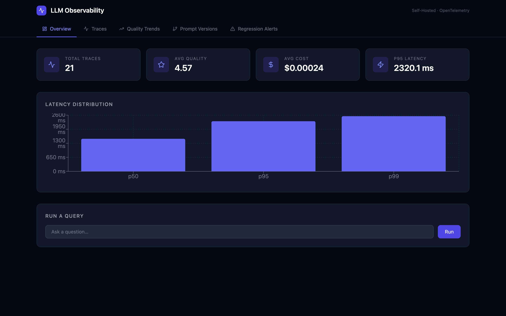
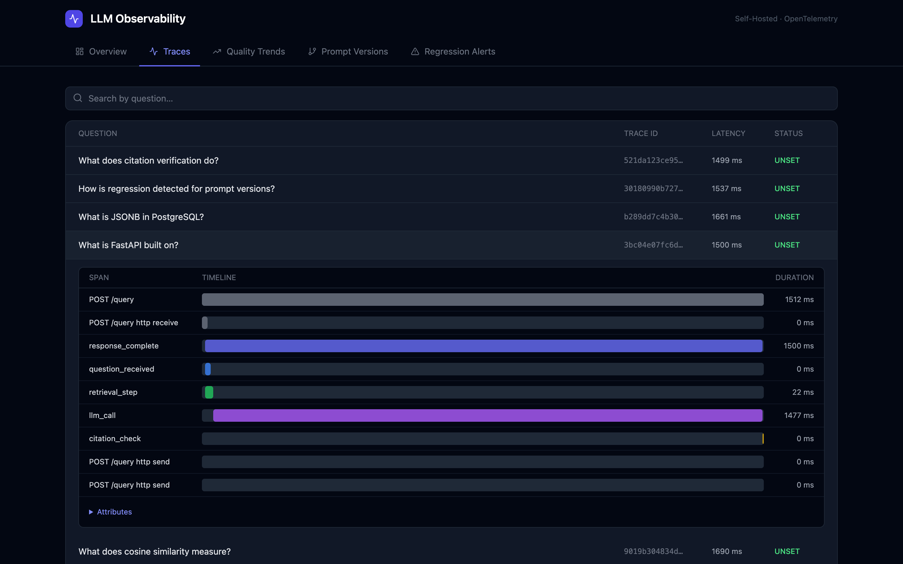
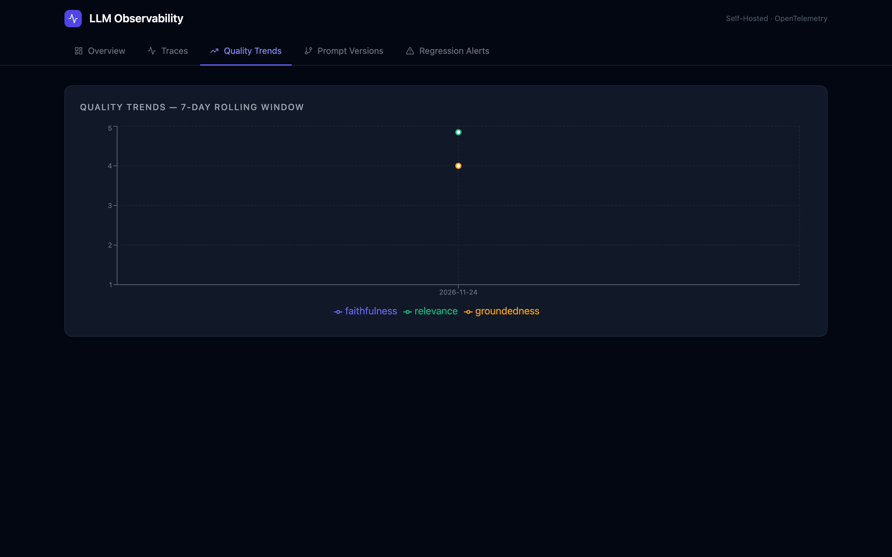
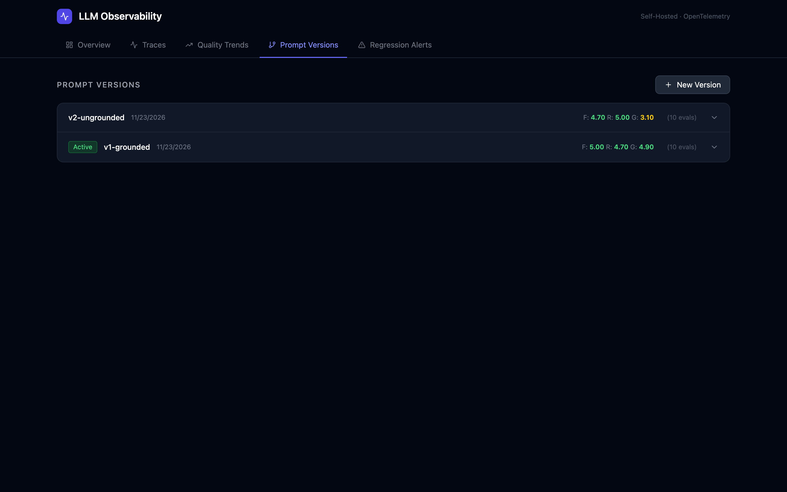
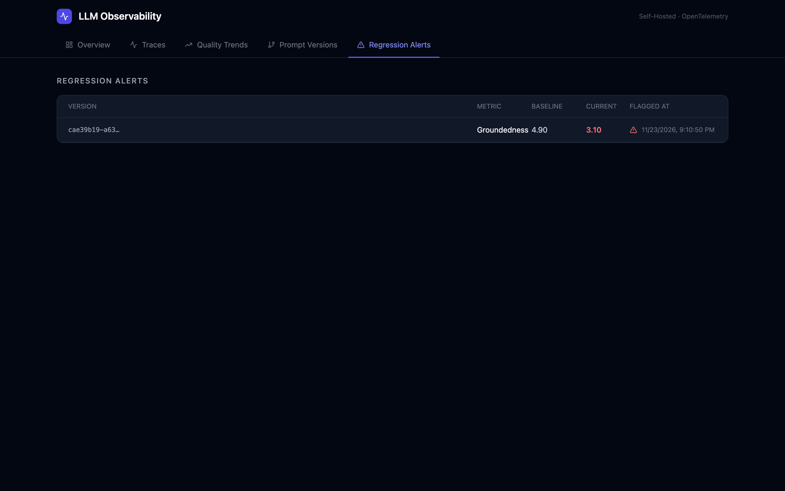
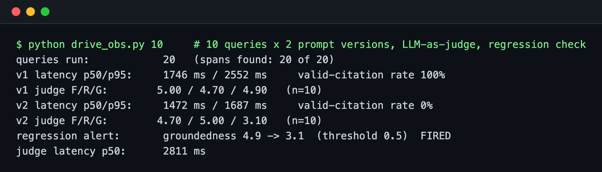

# LLM Observability Platform

Self-hosted **observability and evaluation platform for LLM / RAG pipelines**: distributed tracing with **OpenTelemetry**, automated **LLM-as-judge** quality scoring, **prompt versioning with A/B comparison**, and **automatic regression detection** — a LangSmith-style stack built from scratch with FastAPI, PostgreSQL and React.

> **Keywords:** LLMOps · LLM observability · RAG · OpenTelemetry · distributed tracing · LLM-as-judge · evaluation (faithfulness / relevance / groundedness) · prompt versioning · A/B testing · regression detection · p50/p95/p99 latency · cost tracking · FastAPI · PostgreSQL · React · Docker

## Highlights

- **Automated regression detection:** when a prompt change cut answer groundedness from **4.9 to 3.1 (−1.8 points)** in testing, the platform flagged it automatically against a 0.5-point threshold, and the valid-citation rate fell from 100% to 0%.
- **End-to-end tracing of every RAG query:** a 5-span OpenTelemetry trace persisted to PostgreSQL, with a waterfall view that pinpoints where time goes (the LLM call was ~98% of end-to-end latency in recorded runs).

> Figures come from the scripted run in [`benchmarks/`](benchmarks/) — see [Methodology](#methodology--honest-caveats).

## Tech stack

| Layer | Technologies |
|---|---|
| Backend | Python 3.11, **FastAPI**, **SQLAlchemy 2**, Pydantic v2, Uvicorn |
| Observability | **OpenTelemetry** API/SDK, custom DB span exporter, FastAPI + `requests` auto-instrumentation |
| LLM / RAG | OpenAI Chat Completions (`gpt-4o-mini`) for generation and judging, **sentence-transformers** (`all-MiniLM-L6-v2`) for in-memory dense retrieval, cosine similarity top-k, citation verification |
| Data | **PostgreSQL 15** (JSONB span attributes, indexed trace/span lookups) |
| Frontend | **React 18**, **TypeScript**, Vite, Tailwind CSS, Recharts, React Query |
| Infra | **Docker Compose**, Nginx, health-checked service start order |

## Architecture

```
┌─────────────┐   HTTP    ┌──────────────────────────────────────────┐
│   Browser   │ ◄───────► │  Nginx  →  React Dashboard               │
└─────────────┘           └──────────────────────────────────────────┘
                                           │ /api/*
                                           ▼
                          ┌──────────────────────────────────────────┐
                          │  FastAPI                                  │
                          │  ┌───────────┐  ┌────────────────────┐   │
                          │  │ RAG       │  │  Eval Runner       │   │
                          │  │ Pipeline  │  │  (LLM-as-judge)    │   │
                          │  └───────────┘  └────────────────────┘   │
                          │       │  OpenTelemetry spans              │
                          │       ▼                                   │
                          │  DbSpanExporter (custom)                  │
                          └──────────────────────────────────────────┘
                                           │
                                           ▼
                          ┌──────────────────────────────────────────┐
                          │  PostgreSQL                               │
                          │  spans · evaluations · prompt_versions   │
                          │  regression_alerts                        │
                          └──────────────────────────────────────────┘
```

## Screenshots

*Captured from a local run on a 20-document demo corpus, 10 queries per prompt version.*

| | |
|---|---|
|  |  |
|  |  |
|  | |



## Quick start

Requires Docker and an OpenAI API key.

```bash
cp .env.example .env          # then put your real key in .env (git-ignored)
docker compose up --build
```

Open **http://localhost** (all ports are bound to `127.0.0.1` by default). The first request is slower (~10 s) while the embedding model loads.

| Variable | Default | Description |
|---|---|---|
| `OPENAI_API_KEY` | required | Used by the RAG pipeline and the judge |
| `OPENAI_BASE_URL` | OpenAI | Optional: point at any OpenAI-compatible endpoint |
| `POSTGRES_PASSWORD` | `llmobs` | Set a strong value for anything beyond local use |
| `DATABASE_URL` | set by compose | PostgreSQL connection string |

## API reference

```bash
# Run a RAG query (optionally pin a prompt version)
curl -X POST http://localhost:8000/query -H "Content-Type: application/json" \
  -d '{"question": "What is retrieval-augmented generation?"}'

# Create a prompt version
curl -X POST http://localhost:8000/prompt-versions -H "Content-Type: application/json" \
  -d '{"prompt_text": "Answer ONLY from the documents; cite [Source: N].", "label": "v1", "is_active": true}'

# Judge every un-scored response of a version, then compare against a baseline
curl -X POST "http://localhost:8000/eval/batch?version_id=<uuid>&baseline_version_id=<uuid>"

# Score one response / list traces / list alerts / KPIs
curl -X POST http://localhost:8000/eval ...      # span_id, response_text, user_question, retrieved_context
curl "http://localhost:8000/traces?search=cosine"
curl http://localhost:8000/regression-alerts
curl http://localhost:8000/overview
```

Interactive docs: `http://localhost:8000/docs`.

## Regression detection

For each metric (faithfulness, relevance, groundedness) the candidate version's mean over its most recent 50 evaluations is compared with the baseline's. A drop larger than **0.5 points** writes a row to `regression_alerts` and surfaces it in the dashboard. Versions with no evaluations are skipped rather than compared against a default score.

## Dashboard

| Tab | Description |
|---|---|
| Overview | KPI cards (traces, avg quality, avg cost, p95 latency), latency distribution, live query box |
| Traces | Searchable trace list with a per-span waterfall |
| Quality Trends | Rolling quality scores over time |
| Prompt Versions | A/B comparison with per-version average scores and batch-eval trigger |
| Regression Alerts | Flagged regressions with baseline vs current score |

## Methodology & honest caveats

- The benchmark ([`benchmarks/run_benchmark.py`](benchmarks/run_benchmark.py)) creates two prompt versions (grounded vs ungrounded), runs 10 queries each, scores all 20 responses with the judge, and triggers the regression check.
- The recorded run used a **local Claude-CLI-backed, OpenAI-compatible stand-in** instead of the OpenAI API, so absolute latency, token cost and judge scores are illustrative. Re-run with your own key for production figures.
- The demo corpus is 20 short documents; retrieval quality on real corpora is not evaluated here.

## Security notes

Designed for local / trusted-network use. No secrets are committed (`.env` is git-ignored and excluded from Docker images), published ports bind to localhost, and DB credentials are overridable via environment. There is no authentication layer and CORS is permissive — add auth and restrict origins before exposing it.

## Project layout

```
backend/app/    main.py · models.py · routers/ (traces, eval, versions, alerts) · pipeline/ (rag, vector_store) · eval/ (runner, regression)
backend/migrations/init.sql
frontend/src/   views/ (Overview, Traces, QualityTrends, PromptVersions, RegressionAlerts) · api/client.ts
benchmarks/     reproducible benchmark script
```
